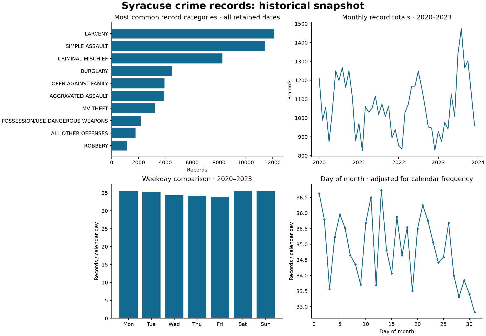

# Syracuse Crime Data Analysis

A reproducible analysis of a historical Syracuse crime-record snapshot, by Ivan Chen. It examines category composition and calendar patterns while separating observed record counts from claims about causes or public safety.

**Current result:** 55,779 usable records from 55,851 rows in the 2020–2024 source tables. The audit accounts for 72 excluded rows. **2024 is partial** and is excluded from calendar-pattern comparisons. The bundled data is historical, not a live feed.



Read the [findings](reports/findings.md), [machine-readable audit](reports/summary.json), and [artifact index](ARTIFACTS.md). The companion [temporal model](https://github.com/ichen27/Temporal-Crime-Prediction-Classification-Model-w-Random-Forest-) evaluates how much crime category can be learned from calendar features alone.

## Quickstart

Requires Git and Python 3.12 (recommended). From a fresh checkout of the current PR branch:

```bash
git clone --branch feat/reproducible-crime-analysis https://github.com/ichen27/Syracuse-Crime-Data-Analysis.git
cd Syracuse-Crime-Data-Analysis
python3 -m venv .venv
source .venv/bin/activate
python -m pip install -r requirements-lock.txt
python -m pip install --no-deps -e .
syracuse-analyze --database crime_data.db --output reports
```

On Windows activate with `.venv\Scripts\activate`. The command runs without a display or network access after installation, leaves the database unchanged, and writes `findings.md`, `summary.json`, and `overview.png`. For another compatible snapshot, pass its SQLite path via `--database`; review the fixed 2020–2023 comparison window before interpreting results.

## What the analysis fixes

- Reads both `CODE_DEFINED` and `CODE DEFINED` after validating the actual schema. Quoting a nonexistent SQLite column can otherwise create a literal category.
- Parses the US-style AM/PM dates in 2022 Part 2 alongside the other timestamp formats. Preserves the calendar day written in `DATEEND` because midnight/offset conventions differ across tables.
- Audits invalid dates, missing categories, dates outside the requested window, source tables, and the database SHA-256.
- Compares day numbers and weekdays using records per calendar day, including zero-record dates. The 31st occurs less often; its raw total is not directly comparable to the 1st.
- Uses only 2020–2023 for calendar-pattern charts and explicitly identifies partial 2024.

## Data and limitations

`crime_data.db` is the existing repository snapshot, preserved byte-for-byte. Its ten 2020–2024 tables contain 55,851 rows; the 2,000-row 2019 table is excluded. Retained rows are grouped by their actual source calendar date, which can differ from the table year. This is why table totals and year totals differ.

The original project attributes the data to public Syracuse crime records. The historical acquisition script contains an ArcGIS service URL, but there is no complete acquisition manifest or verified completeness record for this snapshot. The 2019 script lacks pagination; it is archived and is not a supported refresh mechanism. Data provenance and collection coverage need verification before expanding the dataset.

These are **source records**, not verified unique incidents or population-adjusted crime rates. Multiple records with the same date and category are retained because they can be legitimate separate events. The available IDs do not establish cross-table identity. Calendar exposure assumes coverage throughout 2020–2023; an empty date cannot establish that no crime occurred. The city’s [2023 Part 1 metadata](https://www.arcgis.com/sharing/rest/content/items/94bc33f1a2c646b995d1ab356edf0730/info/metadata/metadata.xml?format=default&output=html) defines `DATEEND` as the date reported, correcting the earlier incident-end-date description. Historical publication/revision timing remains unknown, and identical semantics across older tables have not been verified. Coordinates are not available consistently across all years. These descriptive results do not establish causality, neighborhood risk, or the effectiveness of an intervention.

The [original notebook and scripts](legacy/) are preserved for historical context. Their old results and unsupported interpretations are superseded by the audited reports; they are outside the maintained execution path.

## Development

```bash
ruff check src tests
pytest -q
syracuse-analyze --output work/reports
```

CI runs these checks on pushes and pull requests. Tests cover the spaced column name, multiple date formats, invalid rows, read-only loading, calendar denominators, and snapshot reconciliation. Keep changes on feature branches and submit a PR. Include reproduction steps, expected behavior, and dependency versions in issue reports; use synthetic examples instead of pasting individual record details.

## Attribution and licensing

Original analysis: Ivan Chen. Third-party packages retain their respective licenses. This repository did not specify a code or dataset license; this update does not grant new redistribution rights. Verify source terms and obtain a license decision before redistribution or a licensed release.

## Source-tail follow-up

An October 15, 2026 query of the city’s 2023 Part 1 service matches the original database’s December larceny daily counts and also ends December 26, with four records in December 25–31. This confirms the sparse tail is present in the served source; it does not establish whether the remaining days were missing or had zero records. See the model repository’s [dated aggregate audit](https://github.com/ichen27/Temporal-Crime-Prediction-Classification-Model-w-Random-Forest-/blob/feat/temporal-model-evaluation/reports/smoothing/source-audit.json). The original database and loader behavior are unchanged.
